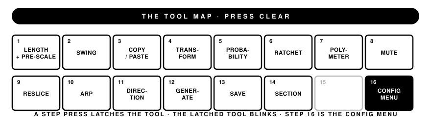

Open firmware for the Roland TR-808 Rhythm Composer, running on a drop-in replacement for
the machine's original NEC µPD650C processor — any AT90USB1286 board in the µPD650C socket
(Teensy++ 2.0 class). It drives the same scan matrix, step LEDs and common-trigger lines the
stock CPU used. Nothing on the analog side is modified, so the drum voices sound exactly like
a stock 808.

**Status: v0.4.** It runs on hardware, and the panel layer — every
gesture, tool, and menu — is machine-verified by an automated harness that presses the keys
over SysEx and reads the state back. A `combined` build also carries an emulator of the
stock µPD650C-085, so one board boots either the original behaviour or the extended one.

## The 808's model, kept

- **32 patterns**: 16 STEP buttons × variations A/B. Buttons 1–12 are BASIC RHYTHM,
  13–16 are INTRO/FILL IN.
- **A measure is 1st PART + 2nd PART**, up to 16 steps each, with independent step counts —
  that's how 20-step and other odd measures are written.
- **PRE SCALE** sets steps per beat: 3, 6, 4 or 8.
- **TAP** inserts intros and fills in the play modes and writes steps in real time in the
  write modes. Inside the first beat of a measure it turns that measure into the fill.
  **AUTO FILL IN** drops a fill every 2/4/8/12/16 measures; fills count toward N, an intro
  does not, and AB keeps alternating through fills.
- **Rhythm tracks**, 12 × 64 measures. PLAY plays a track from measure 1 and loops; COMPOSE
  records it live (CLEAR, then START: every pattern, fill, intro and auto fill is
  memorized) or edits it in place (START: the keys overwrite the measures they land in).
  The panel gives the CPU one code for both detents; with the Play/Compose wire fitted
  (the MODE switch's memory-protect deck read on PI0) superOS tells them apart as stock,
  and without it both act as PLAY, CLEAR then START records and CLEAR twice then START
  edits.

Nothing superOS adds moves a stock control. START/STOP, TAP and FILL IN keep their factory
behaviour in every mode.

## What superOS adds

The 808 has exactly one free momentary button, so the whole extended layer hangs off
**CLEAR**. Press it and the tool map is on the step LEDs instantly — in the write modes and
in MANUAL PLAY — for as long as the button is down. A step press latches that tool.



- **Patterns to 64 steps** in four sections; writing a part that doesn't exist yet creates it.
- **Per-step probability and ratchets**, per-voice **loop length**, **polymeter**,
  **direction** and **pre-scale** — one voice can run backward, at its own length, at its
  own rate, against the pattern. All of it saved with the pattern.
- **Swing**, pattern **direction**, live **mutes**, momentary **reslice**, an **arp**,
  pattern **generate**, **copy/paste**, **transform**, chained slots drawn on the LEDs.
- **MIDI in/out** over the MIDI jacks and USB-C: the voices on the GM drum map
  (velocity ≥ 100 accents), program change for pattern selection (0–15 = A, 16–31 = B),
  clock sync as slave or master with jitter smoothing, soft thru. Clock follows one port at
  a time, so a master on both does not double the tempo. Four config-menu switches turn
  SysEx in, SysEx out, notes in and notes out off independently.
- A **web editor** over SysEx (`tools/web-editor/index.html`): live two-way pattern grid,
  file backup, settings, panel calibration, firmware and program-image upload.
- **Firmware updates over the 808's own MIDI IN** — no disassembly after the first install.

Patterns, tracks, settings and the panel decode table persist in a wear-leveled
internal-flash block store. No battery involved.

## D650C mode

`combined` builds carry both firmwares; a byte in EEPROM picks one per boot, and menu
step 9 switches sides at a press. In D650C mode the TR-808 behaves exactly as it left the
factory — same program, same timing — plus MIDI clock sync, **instant step entry** (the
1981 program drops fast presses; the bridge lands every one, the moment the key goes
down), and the config menu opens in place while the machine keeps playing.

The original program is **not** included: you upload a 2048-byte transfer of your own
chip's program once, over MIDI, and it stays on the board.

## Building

[PlatformIO](https://platformio.org). The tree must be a git checkout (the build scripts
stamp the version from git).

```
pio run -e bootloader -e flash-service   # once, for the -full.hex fold
pio run -e app-flash                     # SuperOS, no emulator
```

Every release ships two files, and the flash service is folded into both — there is
nothing else to install:

| File | For |
|---|---|
| `SuperOS-808_*.syx` | Updating a machine over its own MIDI IN (hold STEP 1 at power-on, send with `tools/send_syx.py`) |
| `SuperOS-808_*-full.hex` | Programming a fresh board over ISP: app + bootloader + flash service |

The `combined` environments additionally need your own program-image transfer:
`python3 tools/d650/make_image_embed.py <your-transfer.syx>` — the generated header is
gitignored and never leaves your checkout.

## Bring-up

The 808's rotaries reach the CPU through a 1981 diode encoder whose truth table is **data,
not code**. The firmware ships with a table measured on a real machine; if a control does
the wrong thing on yours, run the guided calibration from the web editor (or config-menu
step 8) and the measured table is stored to flash.

## Manual

The full Owner's Manual (v0.4) covers every gesture, tool and menu item:
[superos303.com/doc/808](https://superos303.com/doc/808), with a PDF and a one-page-per-function
Shortcut Guide there too.

---

*Roland and TR-808 are trademarks of Roland Corporation, used solely to identify
compatibility. This project is not affiliated with, endorsed, or sponsored by Roland
Corporation.*
